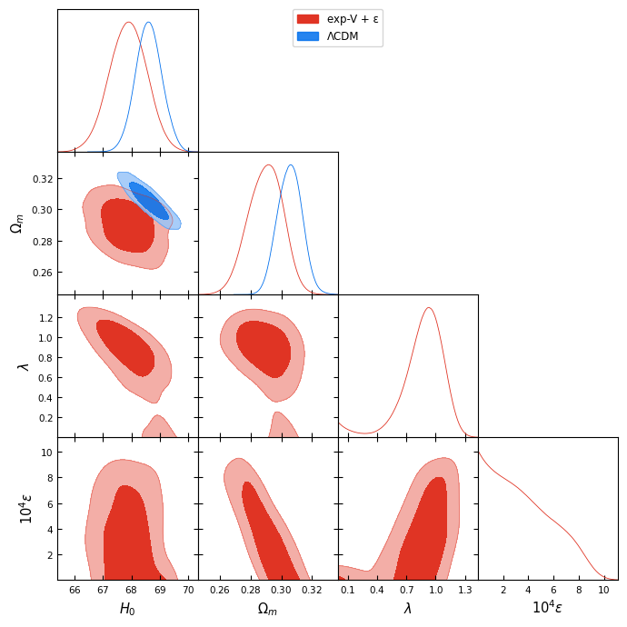
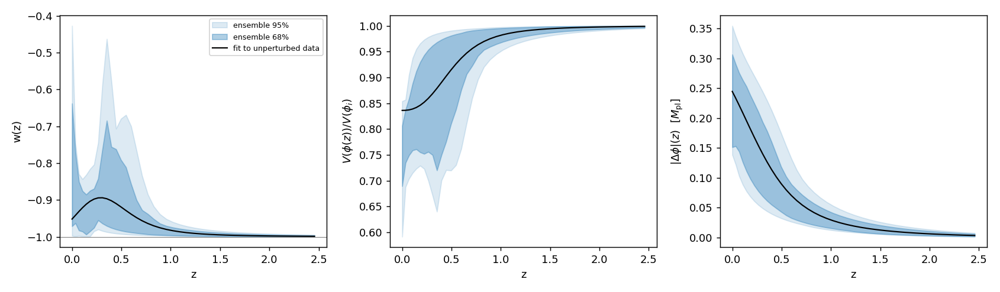
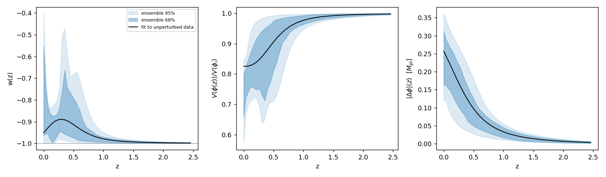
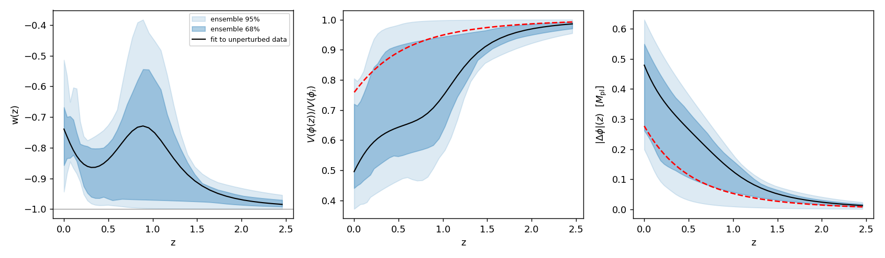

# Fit results (auto-generated by src/analysis.py)

### r_d prior: free

| model | k | ω_m | H0 [km/s/Mpc] | Ω_m | λ (95% up) | ε=α_eff H0²/c² (95% up) | w0 | r_d [Mpc] |
|---|---|---|---|---|---|---|---|---|
| ΛCDM | 4 | 0.1442 (+0.0170 / −0.0162) | 68.42 (+4.32 / −4.15) | 0.3047 (+0.0080 / −0.0075) | 0 (fixed) | 0 (fixed) | −1 | 146.72 (+8.90 / −7.89) |
| ΛCDM + ε | 5 | 0.1408 (+0.0167 / −0.0161) | 69.11 (+4.02 / −3.60) | 0.3005 (+0.0090 / −0.0092) | 0 (fixed) | < 3.5e-04 | −1 | 147.64 (+9.03 / −7.98) |
| exp-V | 5 | 0.1400 (+0.0169 / −0.0159) | 67.86 (+3.79 / −3.95) | 0.3033 (+0.0082 / −0.0081) | < 1.04 | 0 (fixed) | -0.917 (+0.051 / −0.050) | 146.95 (+8.94 / −7.93) |
| exp-V + ε | 6 | 0.1315 (+0.0157 / −0.0149) | 65.80 (+3.98 / −3.79) | 0.2914 (+0.0116 / −0.0115) | < 1.16 | < 7.7e-04 | -0.869 (+0.051 / −0.051) | 147.84 (+9.00 / −7.71) |

| model | χ²_CC | χ²_BAO | χ²_SN | χ²_rd-prior | χ²_tot | Δχ² | ΔAIC | ΔBIC | H0 vs SH0ES | H0 vs Planck | τ_max | N_eff | acc. |
|---|---|---|---|---|---|---|---|---|---|---|---|---|---|
| ΛCDM | 6.24 | 10.97 | 1388.87 | 0.00 | 1406.08 | +0.00 | +0.00 | +0.00 | 1.1σ | 0.2σ | 115 | 2505 | 0.55 |
| ΛCDM + ε | 6.24 | 10.97 | 1388.87 | 0.00 | 1406.08 | +0.00 | +2.00 | +7.38 | 1.0σ | 0.5σ | 192 | 1498 | 0.46 |
| exp-V | 6.39 | 8.72 | 1386.03 | 0.00 | 1401.14 | -4.95 | -2.95 | +2.44 | 1.3σ | 0.1σ | 191 | 1512 | 0.45 |
| exp-V + ε | 6.47 | 8.24 | 1386.14 | 0.00 | 1400.85 | -5.23 | -1.23 | +9.53 | 1.8σ | 0.4σ | 239 | 1204 | 0.40 |

Best-fit points: ΛCDM: {'om': 0.1424, 'u0': 0.3255, 'rd': 147.6}, H0=68.41, w0=-1.000; ΛCDM + ε: {'om': 0.1424, 'u0': 0.3255, 'eps': 1.386e-10, 'rd': 147.6}, H0=68.40, w0=-1.000; exp-V: {'om': 0.1376, 'u0': 0.3695, 'lam': 0.8222, 'rd': 147.9}, H0=67.37, w0=-0.896; exp-V + ε: {'om': 0.1332, 'u0': 0.3902, 'lam': 0.9157, 'eps': 0.0005354, 'rd': 148.0}, H0=67.34, w0=-0.868

### r_d prior: planck

| model | k | ω_m | H0 [km/s/Mpc] | Ω_m | λ (95% up) | ε=α_eff H0²/c² (95% up) | w0 | r_d [Mpc] |
|---|---|---|---|---|---|---|---|---|
| ΛCDM | 4 | 0.1435 (+0.0022 / −0.0022) | 68.61 (+0.45 / −0.45) | 0.3055 (+0.0079 / −0.0083) | 0 (fixed) | 0 (fixed) | −1 | 147.10 (+0.26 / −0.27) |
| ΛCDM + ε | 5 | 0.1419 (+0.0025 / −0.0027) | 68.70 (+0.53 / −0.48) | 0.3011 (+0.0088 / −0.0095) | 0 (fixed) | < 4.1e-04 | −1 | 147.08 (+0.26 / −0.26) |
| exp-V | 5 | 0.1396 (+0.0031 / −0.0030) | 67.81 (+0.68 / −0.57) | 0.3033 (+0.0079 / −0.0082) | < 1.05 | 0 (fixed) | -0.900 (+0.044 / −0.050) | 147.08 (+0.27 / −0.26) |
| exp-V + ε | 6 | 0.1330 (+0.0051 / −0.0054) | 67.89 (+0.65 / −0.67) | 0.2901 (+0.0108 / −0.0122) | < 1.16 | < 8.2e-04 | -0.871 (+0.055 / −0.056) | 147.09 (+0.26 / −0.26) |

| model | χ²_CC | χ²_BAO | χ²_SN | χ²_rd-prior | χ²_tot | Δχ² | ΔAIC | ΔBIC | H0 vs SH0ES | H0 vs Planck | τ_max | N_eff | acc. |
|---|---|---|---|---|---|---|---|---|---|---|---|---|---|
| ΛCDM | 6.25 | 10.97 | 1388.87 | 0.00 | 1406.08 | +0.00 | +0.00 | +0.00 | 3.9σ | 1.8σ | 40 | 2409 | 0.65 |
| ΛCDM + ε | 6.25 | 10.97 | 1388.87 | 0.00 | 1406.08 | +0.00 | +2.00 | +7.38 | 3.7σ | 1.8σ | 52 | 1836 | 0.55 |
| exp-V | 6.40 | 8.72 | 1386.03 | 0.00 | 1401.15 | -4.94 | -2.94 | +2.44 | 4.3σ | 0.5σ | 66 | 1452 | 0.56 |
| exp-V + ε | 6.48 | 8.24 | 1386.14 | 0.00 | 1400.86 | -5.22 | -1.22 | +9.54 | 4.2σ | 0.6σ | 117 | 2472 | 0.49 |

Best-fit points: ΛCDM: {'om': 0.1435, 'u0': 0.3278, 'rd': 147.1}, H0=68.65, w0=-1.000; ΛCDM + ε: {'om': 0.1435, 'u0': 0.3278, 'eps': 0.0, 'rd': 147.1}, H0=68.65, w0=-1.000; exp-V: {'om': 0.1392, 'u0': 0.3738, 'lam': 0.8219, 'rd': 147.1}, H0=67.76, w0=-0.896; exp-V + ε: {'om': 0.1348, 'u0': 0.3948, 'lam': 0.9153, 'eps': 0.000528, 'rd': 147.1}, H0=67.75, w0=-0.868



### Neural potential: nn_planck

```json
{
 "real": {
  "chi2_cc": 6.463969761943519,
  "chi2_bao": 8.284107018318252,
  "chi2_sn": 1386.018294043839,
  "chi2_prior": 7.657633438220557e-06,
  "chi2_total": 1400.7663784817341,
  "H0": 67.78971931782704,
  "Om": 0.3016947749312105,
  "w0": -0.9519533080076424,
  "dphi": 0.24457939898139464,
  "eps_H0": 0.0
 },
 "ensemble_16_50_84": {
  "H0": [
   66.92905069340327,
   67.39972853124132,
   67.89573142252408
  ],
  "Om": [
   0.2893250840063119,
   0.3016404396060122,
   0.31216997670615604
  ],
  "w0": [
   -0.9714244200474558,
   -0.8682010786890514,
   -0.6383337939657098
  ],
  "dphi": [
   0.1511685631339405,
   0.24255289914769967,
   0.3064015503195714
  ],
  "eps_H0": [
   0.0,
   0.0,
   0.0
  ]
 },
 "runtime_s": 908.7371530532837,
 "B": 24,
 "iters": 1000,
 "n_params_per_member": 323
}
```



Quadratic fit ln V = −λ_eff|Δφ| + ½ c2 Δφ² over the traversed range: λ_eff = 1.76 (+0.98 / −1.70), c2 = 3.88 (+9.22 / −18.41)

### Neural potential: nn_planck_eps

```json
{
 "real": {
  "chi2_cc": 6.479682465866586,
  "chi2_bao": 8.09957722116497,
  "chi2_sn": 1386.0189909264445,
  "chi2_prior": 8.226227663240253e-06,
  "chi2_total": 1400.5982588397037,
  "H0": 67.79472521765906,
  "Om": 0.2994909427915886,
  "w0": -0.9512256538602534,
  "dphi": 0.2564968299338058,
  "eps_H0": 4.88217403651659e-05
 },
 "ensemble_16_50_84": {
  "H0": [
   66.93429980058923,
   67.2566160948596,
   67.76225812451516
  ],
  "Om": [
   0.2890488403908399,
   0.29928543111668526,
   0.3098205987340393
  ],
  "w0": [
   -0.9634601108319224,
   -0.8477339622286724,
   -0.553832923881242
  ],
  "dphi": [
   0.16141149116490783,
   0.23266208382863088,
   0.3129686073132611
  ],
  "eps_H0": [
   7.412860922090345e-06,
   4.585615606900781e-05,
   0.00014312447704918158
  ]
 },
 "runtime_s": 914.4337368011475,
 "B": 24,
 "iters": 1000,
 "n_params_per_member": 324
}
```



Quadratic fit ln V = −λ_eff|Δφ| + ½ c2 Δφ² over the traversed range: λ_eff = 1.78 (+0.85 / −1.52), c2 = 4.04 (+8.52 / −13.76)

### Neural potential: nn_planck_mock

```json
{
 "real": {
  "chi2_cc": 7.038911610869159,
  "chi2_bao": 24.889303154633225,
  "chi2_sn": 1562.361965149641,
  "chi2_prior": 3.0159086578318852e-05,
  "chi2_total": 1594.2902100742301,
  "H0": 63.16996944007849,
  "Om": 0.33094208765818495,
  "w0": -0.7392933659889299,
  "dphi": 0.47920937964216503,
  "eps_H0": 0.0
 },
 "ensemble_16_50_84": {
  "H0": [
   62.532767843437014,
   63.20986170062515,
   63.55966582569122
  ],
  "Om": [
   0.31252244258359946,
   0.3385964491183473,
   0.35513688410935
  ],
  "w0": [
   -0.8575094561544812,
   -0.7935997717544263,
   -0.6683083992221279
  ],
  "dphi": [
   0.26166591854953636,
   0.42118459594760604,
   0.5496295098619322
  ],
  "eps_H0": [
   0.0,
   0.0,
   0.0
  ]
 },
 "runtime_s": 906.1758160591125,
 "B": 24,
 "iters": 1000,
 "n_params_per_member": 323
}
```



Quadratic fit ln V = −λ_eff|Δφ| + ½ c2 Δφ² over the traversed range: λ_eff = 1.68 (+1.36 / −0.86), c2 = 2.23 (+3.64 / −4.83)

### Fisher / identifiability (fisher.py)

```json
{
 "F1": {
  "grad_autodiff": [
   -6957.640111547504,
   -2288.512342216385,
   105.70483851494076,
   -9963.188405861722,
   -23.47433097083613
  ],
  "grad_fd": [
   -6957.642849306466,
   -2288.510339644745,
   105.7047560425417,
   -9963.13144355554,
   -23.474331056490882
  ],
  "max_rel_diff": 5.717276825603872e-06,
  "t_forward_s": 0.16573699994478375,
  "t_autodiff_grad_s": 0.41084570001112297,
  "t_fd_grad_s": 1.1507115000276826
 },
 "F2": {
  "lcdm": {
   "om": {
    "fisher": 0.00218863423464233,
    "mcmc_std": 0.00221920260906025
   },
   "u0": {
    "fisher": 0.007908666145983196,
    "mcmc_std": 0.007952950774535995
   },
   "rd": {
    "fisher": 0.2598769426086167,
    "mcmc_std": 0.2644697641332574
   },
   "t_jacobian_s": 12.981440600007772,
   "mcmc_runtime_s": 1408.7655148506165
  },
  "exp": {
   "om": {
    "fisher": 0.0029380368276329064,
    "mcmc_std": 0.002993227783237872
   },
   "u0": {
    "fisher": 0.024075415974728932,
    "mcmc_std": 0.02514894543699655
   },
   "lam": {
    "fisher": 0.17470759811771952,
    "mcmc_std": 0.2280259244834342
   },
   "rd": {
    "fisher": 0.2598765393042381,
    "mcmc_std": 0.2627573575420062
   },
   "t_jacobian_s": 10.259244799963199,
   "mcmc_runtime_s": 1472.4383206367493
  }
 },
 "F3": {
  "lam_fid": 0.8218612226907805,
  "phi_ref": 0.2541770013399758,
  "w0_fid": -0.895901908957003,
  "GR (eps=0)": {
   "sigma_modes": [
    0.004376422833986849,
    0.0234306625843881,
    0.0510046546102416,
    0.0937887180451617,
    0.19260554587734005,
    1.2914177703366039
   ],
   "eigvecs_legendre": [
    [
     -0.15994085640900663,
     -0.27545573989547717,
     0.4200636805113009,
     -0.44492171940193326,
     0.4943866331024988,
     -0.528881917576212
    ],
    [
     0.062401597817431265,
     -0.9468057201502651,
     -0.1167623453408255,
     0.2379203014379429,
     -0.010878069790112,
     0.17119322811489732
    ],
    [
     0.0733095047949838,
     -0.03993032159275696,
     0.8586131488676122,
     0.12390306639902914,
     -0.4711567849598855,
     0.13591931665160686
    ],
    [
     -0.04504855273508704,
     0.09613765049344075,
     0.05714154096674302,
     0.8187789760788046,
     0.1481076226012524,
     -0.5414130999604372
    ],
    [
     -0.0789921738248179,
     -0.12920427434259138,
     -0.26340912168129654,
     -0.23145906826037474,
     -0.7121537618480095,
     -0.5890210911222875
    ],
    [
     0.9782032221980271,
     0.012346688466056984,
     -0.006855547278498854,
     -0.0781940659922922,
     0.06615104085813647,
     -0.18007982861444943
    ]
   ],
   "n_modes_sigma_lt_0p1": 4,
   "n_modes_sigma_lt_1": 5
  },
  "eps free": {
   "sigma_modes": [
    0.005608852186286675,
    0.030236610924440563,
    0.07309504531498427,
    0.1385317011585216,
    0.2411968253915312,
    8.158375513769831
   ],
   "eigvecs_legendre": [
    [
     -0.14794295958671766,
     -0.3765097323975082,
     0.4382625809290118,
     -0.4206074288835059,
     0.4723485884893546,
     -0.4942220290479192
    ],
    [
     0.03504510406559111,
     -0.8333764054163394,
     -0.4543935212044114,
     0.2719839913029838,
     0.11642551119253285,
     0.1012518853270679
    ],
    [
     0.029550234839144672,
     -0.1959095791652773,
     0.6168185769333119,
     0.648546305361234,
     -0.3477124679708283,
     -0.19688776747712877
    ],
    [
     -0.007210564184528729,
     -0.3461038582536067,
     0.17569601529599704,
     -0.5641947128224812,
     -0.6857666306704868,
     0.24637266804015182
    ],
    [
     -0.006131870888137202,
     -0.07059266918165831,
     0.43080683527572156,
     0.03126640511585718,
     0.40816223940716506,
     0.8011307909013343
    ],
    [
     0.9878876013668046,
     -0.023925289054862985,
     0.06725817484654184,
     -0.09596107012474848,
     0.07453633673775424,
     -0.06494469225367358
    ]
   ],
   "n_modes_sigma_lt_0p1": 3,
   "n_modes_sigma_lt_1": 5
  }
 },
 "F4": {
  "V fixed up to amplitude (c0)": {
   "sigma_eps_tilde": 0.0006160981613165435,
   "sigma_eps_H0": 0.0002829160459739181,
   "corr_with": {
    "ln_om": -0.8699645843984123,
    "ln_rd": -0.0002515863911396361,
    "eps": 1.0,
    "c0": 0.6941767906313923
   }
  },
  "amplitude+slope (c0,c1)": {
   "sigma_eps_tilde": 0.0009009690983446671,
   "sigma_eps_H0": 0.0004137305235640781,
   "corr_with": {
    "ln_om": -0.9373752421962868,
    "ln_rd": 7.582625370890378e-05,
    "eps": 1.0,
    "c0": 0.8620709382571008,
    "c1": -0.7296533726848743
   }
  },
  "c0..c2": {
   "sigma_eps_tilde": 0.001647932788207132,
   "sigma_eps_H0": 0.0007567408210958685,
   "corr_with": {
    "ln_om": -0.9772058457770904,
    "ln_rd": -0.00029472195289552904,
    "eps": 1.0,
    "c0": 0.9301250945328656,
    "c1": -0.857596147255123,
    "c2": 0.8373110259151048
   }
  },
  "c0..c5": {
   "sigma_eps_tilde": 0.012282426875804626,
   "sigma_eps_H0": 0.005640165585368581,
   "corr_with": {
    "ln_om": -0.9975267443934887,
    "ln_rd": -0.00089990058343771,
    "eps": 1.0,
    "c0": 0.9876375556448198,
    "c1": -0.9823574934128835,
    "c2": 0.9926491085506752,
    "c3": -0.9852823151086345,
    "c4": 0.9648365184493491,
    "c5": -0.884379350703801
   }
  }
 },
 "F5": {
  "delta_lnV_fiducial": 0.20889822110114867,
  "K=2": {
   "sigma_lnV_amplitude": 0.045278916951424726,
   "sigma_slope": 0.17470735756998884
  },
  "K=3": {
   "sigma_lnV_amplitude": 0.12805136118413848,
   "sigma_slope": 0.17721336071138574,
   "sigma_curvature": 9.001854447781984
  },
  "K=4": {
   "sigma_lnV_amplitude": 0.28225169645113496,
   "sigma_slope": 0.18229990942622307,
   "sigma_curvature": 9.200941798587145
  }
 },
 "F_matrix": [
  [
   13674.505183227244,
   41283.6584786167,
   353277.81764812075,
   7003.5781393253055,
   3417.817818566119,
   -11815.948071327264,
   15190.965849058299,
   -17442.042207312028,
   19600.927241734124
  ],
  [
   41283.65847861669,
   450391.8465185381,
   950796.492176939,
   23862.325572855243,
   1
```
